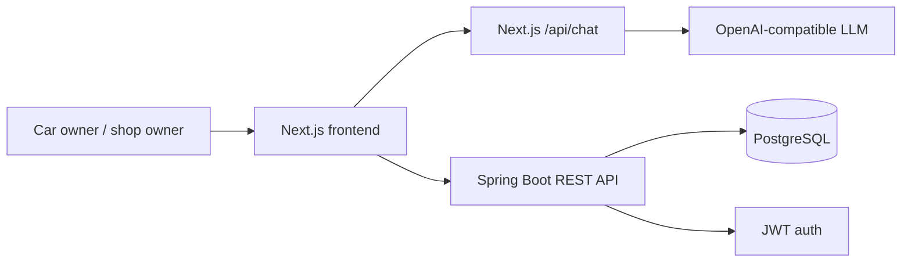

# Architecture Overview

Kapotiabi is a car repair marketplace with a Next.js frontend and Spring Boot backend.

## System Shape

## Main Parts

- **Frontend:** localized public pages, search/chat UI, protected account pages, protected business pages.
- **Backend:** REST API for auth, users, cars, shops, job requests, offers, bookings, reviews, saved shops, and preferences.
- **Database:** PostgreSQL in runtime, H2 in tests, Flyway migrations for schema changes.
- **Auth:** backend issues JWTs; frontend stores demo auth state in `sessionStorage`.
- **Demo bridge:** search compare choices and fallback bookings use `sessionStorage` until fully backed by persisted offers/slots.

## Boundaries

- The backend owns durable business data and authorization.
- The frontend owns the current demo search-to-compare handoff.
- Real backend booking requires an existing `ShopOffer` and `OfferSlot`.
