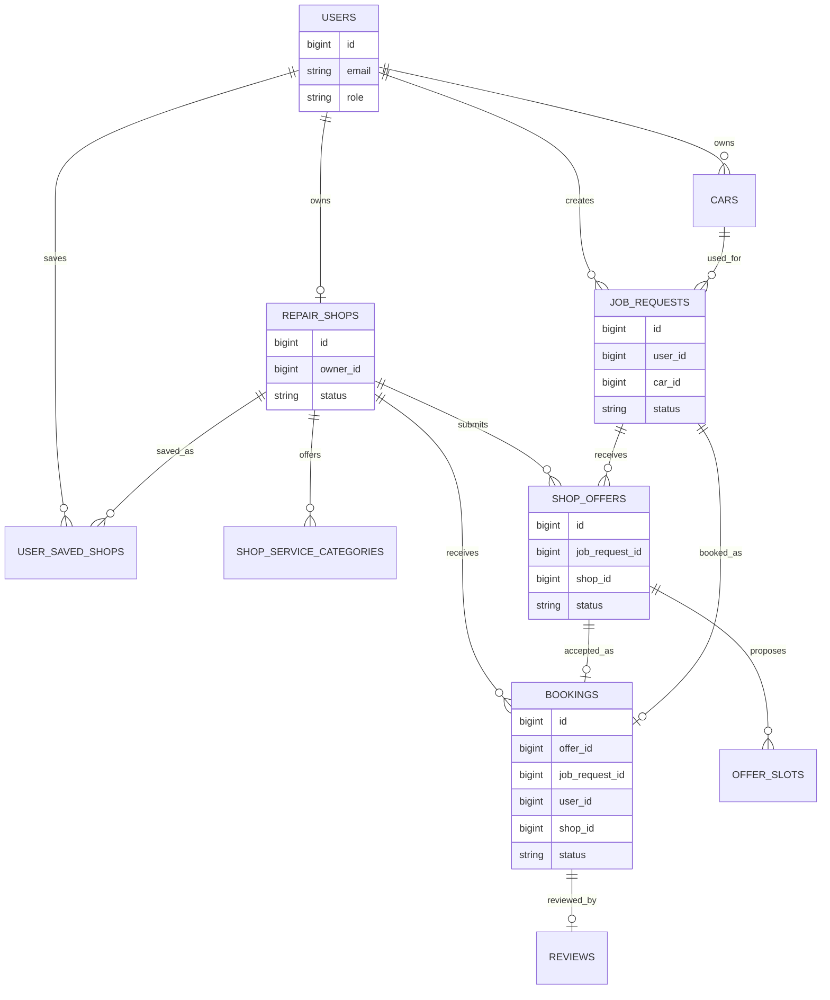

# Database Diagram

This is the practical model used by the backend. See Flyway migrations in `backend/src/main/resources/db/migration` for exact column definitions.

## Key Rules

- Users have roles: car owner, shop owner, or admin.
- A shop owner can own one repair shop.
- A booking is created by accepting a shop offer with a selected offer slot.
- Reviews belong to completed bookings.
