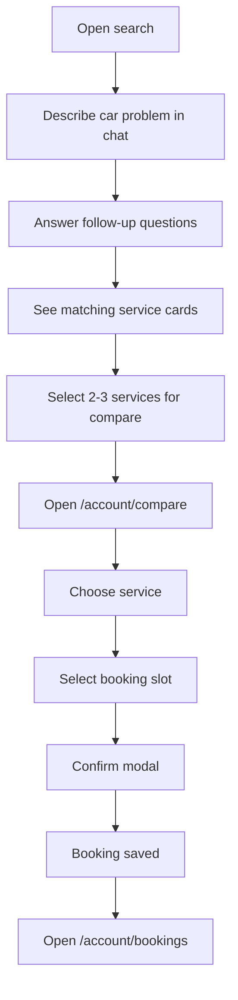
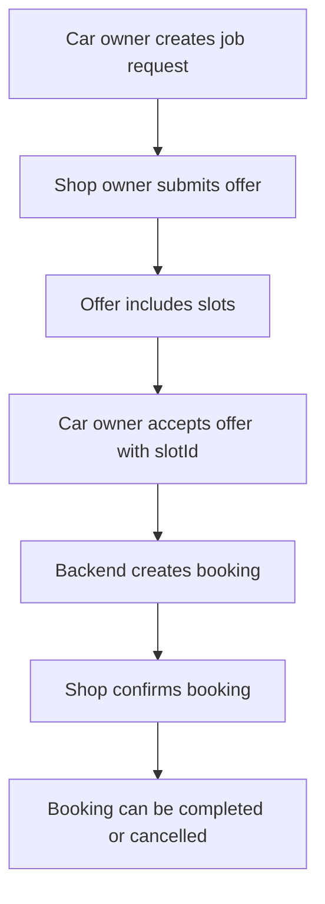

# Product Flow Diagram

## Car Owner Demo Flow

## Backend Booking Flow

## Current Demo Notes

- Search results and compare choices are session-backed for the demo.
- Booking confirmation uses backend only when real `offerId` and `slotId` exist.
- Otherwise, a session booking is created so the full UI flow can be shown.
