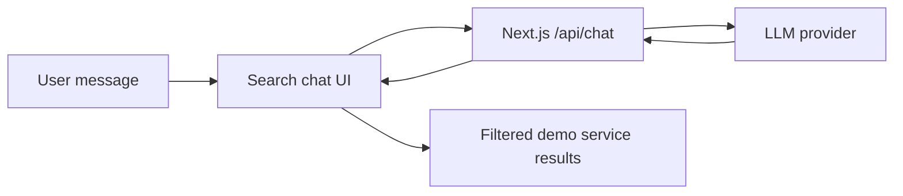

# LLM Usage

The LLM is used only in the frontend search/chat experience.

## Purpose

- Help the user describe a car problem.
- Ask short follow-up questions.
- Extract search filters such as service, city, vehicle, parts preference, and radius.
- Return structured data for the frontend search UI.

## Current Integration

- Entry point: `frontend/src/app/api/chat/route.ts`
- Client UI: `frontend/src/components/search/*`
- Shared filter helpers: `frontend/src/lib/search-chat.ts`

The app does not rely on the LLM for authorization, payments, booking state transitions, or backend database writes.

## Data Flow

## Testing Notes

- Test the happy path with a common request, for example: `I need an oil change for BMW 320d in Tallinn near Kristiine`.
- Verify the assistant asks for missing details before showing results.
- Verify results appear after required filters are collected.
- Verify compare selections survive navigation to `/account/compare`.
